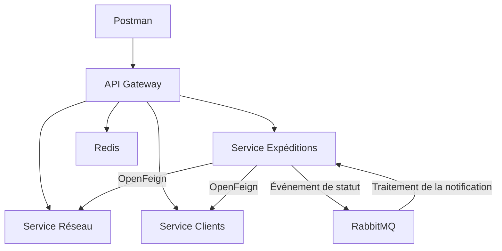

# Quick Ship

Quick Ship est un projet JEE de gestion et de suivi d’expéditions. Il permet de gérer les clients, les dépôts et les tournées, de créer une expédition et de suivre son parcours jusqu’à la livraison ou au retour.

## Fonctionnalités

- Gestion des dépôts et des tournées dans le service Réseau.
- Gestion des clients expéditeurs dans le service Clients.
- Création d’expéditions et gestion de leur historique de suivi.
- Validation du client et de la tournée par des appels OpenFeign lors de la création.
- Transitions du statut `EN_ATTENTE` vers `EN_TRANSIT`, puis vers `LIVRE` ou `RETOUR` dans les scénarios testés.
- Notifications asynchrones de livraison et de retour via RabbitMQ.
- Création idempotente avec l’en-tête `Idempotency-Key`. Un rejeu avec la même clé et le même corps renvoie le même identifiant.
- Limitation de débit sur `/api/routes` dans la Gateway avec Redis.

## Architecture

| Module | Responsabilité |
|---|---|
| `gateway-service` | Point d’entrée des API, routage et limitation de débit |
| `service-reseau` | Dépôts et tournées |
| `client` | Clients expéditeurs |
| `service-expeditions` | Expéditions, suivi et notifications |
| `eureka-server` | Registre et découverte de services |
| `config-server` et `config-repo` | Configuration centralisée du service Réseau |

Les services métier disposent de bases séparées. Une expédition référence son client et sa tournée par leurs identifiants. OpenFeign sert aux validations synchrones lors de la création. RabbitMQ permet le traitement asynchrone des notifications après un changement de statut.



## Démarrage local

Les commandes ci-dessous utilisent les ports de la démonstration locale. La section suivante décrit les paramètres du test depuis un clone neuf.

Installer un JDK Java 17 ou supérieur. Démarrer RabbitMQ sur `localhost:5672` et Redis sur `127.0.0.1:6379`. Les commandes utilisent le Maven Wrapper de chaque module.

Depuis la racine du dépôt, lancer chaque commande dans un terminal distinct.
Attendre le démarrage de Config Server et d’Eureka avant de lancer les services
qui en dépendent.

| Application | Commande depuis la racine | Port |
|---|---|---|
| Config Server | `QUICKSHIP_CONFIG_REPO="$(pwd)/config-repo" && cd config-server && sh ./mvnw spring-boot:run "-Dspring-boot.run.arguments=--spring.cloud.config.server.native.search-locations=file:${QUICKSHIP_CONFIG_REPO}"` | 8888 |
| Eureka | `cd eureka-server && sh ./mvnw spring-boot:run` | 8761 |
| Réseau | `cd service-reseau && sh ./mvnw spring-boot:run` | 8081 |
| Clients | `cd client && sh ./mvnw spring-boot:run '-Dspring-boot.run.arguments=--server.port=8082'` | 8082 |
| Expéditions | `cd service-expeditions && sh ./mvnw spring-boot:run` | 8084 |
| Gateway | `cd gateway-service && sh ./mvnw spring-boot:run` | 8080 |

### Reproduire le test depuis un clone neuf

Le test depuis un clone neuf a utilisé les ports ci-dessous. Lancer chaque
commande depuis la racine du clone, dans un terminal distinct. Démarrer RabbitMQ
et Redis au préalable. Démarrer Config Server et Eureka avant Réseau et Clients,
puis lancer Expéditions et la Gateway. Une instance Eureka disponible sur
`8761` peut être réutilisée.

| Application | Commande depuis la racine du clone | Port |
|---|---|---|
| Eureka | `(cd eureka-server && sh ./mvnw spring-boot:run)` | 8761 |
| Config Server | `(cd config-server && SERVER_PORT=18888 SPRING_CLOUD_CONFIG_SERVER_NATIVE_SEARCH_LOCATIONS="file:$PWD/../config-repo" sh ./mvnw spring-boot:run)` | 18888 |
| Réseau | `(cd service-reseau && SERVER_PORT=18081 SPRING_CONFIG_IMPORT=configserver:http://localhost:18888 sh ./mvnw spring-boot:run)` | 18081 |
| Clients | `(cd client && SERVER_PORT=18082 sh ./mvnw spring-boot:run)` | 18082 |
| Expéditions | `(cd service-expeditions && SERVER_PORT=18084 SERVICES_RESEAU_URL=http://localhost:18081 SERVICES_CLIENTS_URL=http://localhost:18082 sh ./mvnw spring-boot:run)` | 18084 |
| Gateway | `(cd gateway-service && SERVER_PORT=18080 EXPEDITIONS_URL=http://localhost:18084 sh ./mvnw spring-boot:run)` | 18080 |

Vérifier que `GET http://localhost:18888/service-reseau/default` indique le
fichier `config-repo/service-reseau.properties` du clone dans
`propertySources`. Le fichier fournit le port `8081`, et
`SERVER_PORT=18081` fixe le port d’écoute de Réseau pour ce test.

Pour tester les notifications, garder uniquement Expéditions du clone actif
sur le broker RabbitMQ utilisé pour la démo. Si l’instance d’origine tourne
aussi sur `8084`, l’arrêter avant la livraison. Deux instances avec des bases
distinctes et la même file RabbitMQ peuvent traiter chacune des messages de
l’autre environnement.

Le parcours validé dans Postman a créé un client sur `18082`, une tournée sur
`18081` et une expédition sur `18084`. La lecture directe sur `18084` et
la lecture via la Gateway sur `18080` ont renvoyé les mêmes expéditions.
Après livraison via la Gateway, la requête
`GET http://localhost:18080/api/shipment-notifications?customerId=1` a renvoyé
`200 OK` avec la notification `2:LIVRE`. Pour rejouer les exemples ci-dessous
avec le clone, utiliser `18082` pour Clients, `18081` pour Réseau et
`18080` pour la Gateway, puis reprendre les identifiants renvoyés par l’API.

## Démo Postman

Dans la collection **Démo**, ouvrir le dossier **Démo Quick Ship**. Renseigner `gatewayUrl` avec `http://localhost:18080` pour le clone ou `http://localhost:8080` pour le démarrage standard. Préparer un client et une tournée avec les exemples de la section suivante, puis reprendre leurs identifiants dans le corps des requêtes de création et de rejeu.

| Étape | Requête | Résultat attendu |
|---|---|---|
| 1. Créer | `POST /api/shipments`, avec une clé neuve dans `Idempotency-Key` | `201`, statut `EN_ATTENTE` et ID de l’expédition |
| 2. Rejouer | Même URL, même clé et même corps | `201`, même ID |
| 3. Passer en transit | `POST /api/shipments/{{shipmentId}}/transit` | `200`, statut `EN_TRANSIT` |
| 4. Livrer | `POST /api/shipments/{{shipmentId}}/deliver` | `200`, statut `LIVRE` |
| 5. Lister les notifications | `GET /api/shipment-notifications?customerId=<id_client>` | `200`, notification `<id_expédition>:LIVRE` après traitement RabbitMQ |

Avant l’étape 3, renseigner la variable de collection `shipmentId` avec l’ID obtenu à l’étape 1. Lors de la démonstration validée sur la Gateway du clone, les deux premières requêtes ont renvoyé l’ID `6` et la dernière a renvoyé la notification `6:LIVRE` pour le client `1`.

## Exemples avec curl

### Préparer un client et une tournée de test

Utiliser les identifiants renvoyés par les deux créations. Une base H2 en
mémoire perd ses données lorsque le service qui l’utilise redémarre.

```bash
curl -sS -i http://localhost:8082/api/customers \
  -H 'Content-Type: application/json' \
  -d '{"nom":"Client Démo","email":"quickship.demo@example.com","plafondCredit":1000,"statut":"ACTIF"}'

curl -sS -i http://localhost:8081/api/routes \
  -H 'Content-Type: application/json' \
  -d '{"nom":"Tournée Démo","villeDepart":"Casablanca","villeArrivee":"Rabat","dateDepart":"2027-01-15T09:00:00","dureeEstimee":60,"capaciteColis":20}'
```

### Créer puis rejouer une expédition via la Gateway

Adapter `customer_id` et `route_id` aux données de test. Les deux appels
renvoient `201` avec le même ID. La liste contient une seule nouvelle expédition.

```bash
customer_id=1
route_id=1
shipment_key="quickship-demo-$(uuidgen)"

for attempt in 1 2; do
  curl -sS -w '\nHTTP %{http_code}\n' http://localhost:8080/api/shipments \
    -H 'Content-Type: application/json' \
    -H "Idempotency-Key: $shipment_key" \
    -d "{\"customerId\":$customer_id,\"routeId\":$route_id}"
done

curl -sS -i http://localhost:8080/api/shipments
```

### Livrer une expédition et consulter sa notification

Utiliser l’ID de l’expédition créée. Le statut passe à `EN_TRANSIT`, puis à
`LIVRE`. La notification apparaît après le traitement du message RabbitMQ.

```bash
shipment_id=1

curl -fsS -X POST "http://localhost:8080/api/shipments/$shipment_id/transit" &&
echo &&
curl -fsS -X POST "http://localhost:8080/api/shipments/$shipment_id/deliver"
echo

curl -sS -i "http://localhost:8080/api/shipment-notifications?customerId=$customer_id"
```

### Retourner une expédition et consulter sa notification

Créer une seconde expédition avec une nouvelle clé, puis renseigner son ID.
Le statut final est `RETOUR`. La liste des notifications du client contient
alors les entrées `LIVRE` et `RETOUR` pour les expéditions correspondantes.

```bash
curl -sS -i http://localhost:8080/api/shipments \
  -H 'Content-Type: application/json' \
  -H "Idempotency-Key: quickship-retour-$(uuidgen)" \
  -d "{\"customerId\":$customer_id,\"routeId\":$route_id}"
```

```bash
shipment_id=2

curl -fsS -X POST "http://localhost:8080/api/shipments/$shipment_id/transit" &&
echo &&
curl -fsS -X POST "http://localhost:8080/api/shipments/$shipment_id/return"
echo

curl -sS -i "http://localhost:8080/api/shipment-notifications?customerId=$customer_id"
```

### Vérifier la limitation de débit des tournées via la Gateway

Envoyer huit requêtes en parallèle. La rafale de démonstration a donné
trois réponses `200` et cinq `429`. Après reconstitution du quota, la route
a de nouveau répondu `200`.

```bash
for attempt in 1 2 3 4 5 6 7 8; do
  curl -sS --max-time 10 -o /dev/null -w 'HTTP %{http_code}\n' \
    http://localhost:8080/api/routes &
done
wait

sleep 2
curl -sS -i --max-time 10 http://localhost:8080/api/routes
```

### Résultats des tests de validation et de résilience

| Titre du test | Résultat observé |
|---|---|
| Refuser une expédition avec un client ou une tournée inexistante | `400 Bad Request` |
| Refuser une expédition pendant une panne de Clients ou de Réseau | `502 Bad Gateway`, aucune expédition ajoutée |
| Créer une expédition après le rétablissement du service | `201 Created`, sans redémarrer Expéditions |
| Refuser la même clé avec une tournée différente après une réussite | `409 Conflict` |
| Réutiliser la clé après un échec de validation | `400`, puis `201` après correction, puis même ID au rejeu |
| Envoyer deux créations simultanées avec la même clé | Deux réponses `201` avec le même ID et une seule expédition ajoutée |
