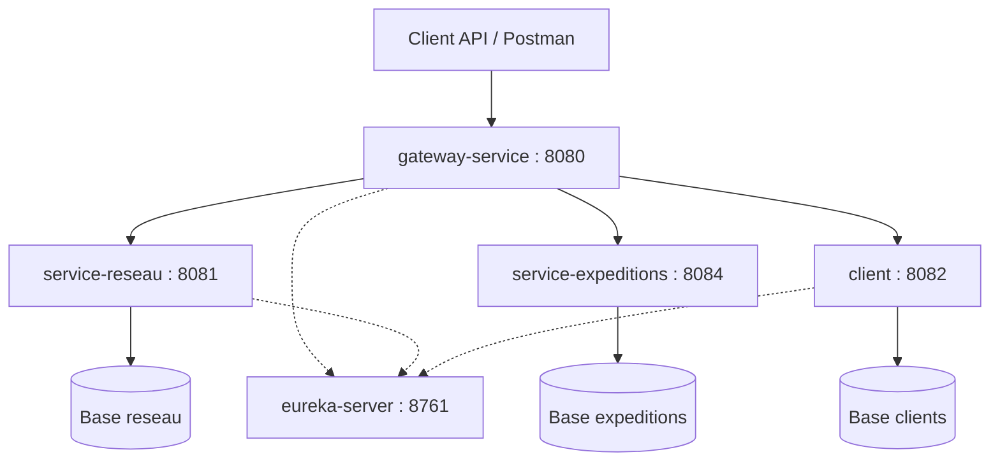

# Quick-Ship — Gestion et suivi de colis

## Présentation

Quick-Ship est une application de gestion d’expéditions.

Elle permet de gérer les clients expéditeurs, les dépôts logistiques,
les tournées de transport et les colis.

Chaque colis possède un numéro de suivi unique. Son parcours est
enregistré jusqu’à sa livraison, son retour ou sa déclaration de perte.
Un colis perdu ou retourné déclenche une réclamation client.

## Fonctionnalités prévues

- Gestion des dépôts et des tournées datées.
- Gestion des clients expéditeurs.
- Création d’une expédition avec calcul du montant côté serveur.
- Vérification du client et réservation de capacité avant départ.
- Suivi des différentes étapes du transport.
- Gestion des livraisons, retours et pertes.
- Consultation d’un colis enrichie avec le client, la tournée,
  les étapes de suivi et les réclamations.
- Notifications asynchrones.

## Cycle de vie cible d’un colis

Un colis commence à l’état EN_ATTENTE.
Après réservation de capacité sur une tournée, il passe à EN_TRANSIT.
Il peut ensuite devenir LIVRE, RETOUR ou PERDU.

## Services et ports de démonstration

| Application | Responsabilité | Port |
|---|---|---|
| service-reseau | Dépôts et tournées | 8081 |
| service-expeditions | Colis et étapes de suivi | 8084 |
| client | Clients expéditeurs | 8082 |
| eureka-server | Annuaire des services | 8761 |
| config-server | Configuration centralisée | 8888 |
| gateway-service | Point d’entrée des API | 8080 |

Chaque service métier possède sa propre base de données.
Aucun service ne consulte directement la base d’un autre service.

Le Config Server fournit la configuration de Réseau. Les notifications de livraison et de retour sont traitées via RabbitMQ.

## Diagramme de classes métier cible

Les associations à l’intérieur d’un service sont locales.
Les dépendances entre services sont représentées en pointillés :
elles indiquent une référence distante sans imposer un protocole.


Les références distantes customerId, routeId et shipmentId
sont stockées comme identifiants, sans association JPA interservice.

TrackingEntry appartient localement à Shipment dans service-expeditions.
Claim appartient localement à Customer dans service-clients.

Dans le périmètre initial, les tournées sont définies par leurs villes.
Aucune association entre Depot et Route n’est imposée par la fiche.

## Architecture de la démonstration



Les liens en pointillés vers Eureka représentent
l’enregistrement et la découverte des services.

## Organisation interne

Chaque service métier respecte les couches suivantes :

- Entity : modèle de données local.
- Repository : accès à la base de données.
- Service : règles métier et transactions.
- Controller : exposition des API REST.
- DTO : validation des entrées et structure des réponses.

## Règles métier principales

- Vérifier l’existence et le statut du client avant le départ.
- Contrôler son encours par rapport au plafond de crédit.
- Vérifier la destination et la capacité de la tournée.
- Réserver atomiquement une unité de capacité avant le départ.
- Calculer le montant du transport côté serveur.
- Libérer une seule fois la capacité à la fin du transport.
- Ajouter une seule fois le montant à l’encours après livraison.
- Créer une seule réclamation automatique par colis retourné ou perdu.
- Contrôler les transitions de statut par des opérations métier.
- Refuser les suppressions incompatibles avec l’historique.

## Plan de réalisation

| Jalon | Contenu |
|---|---|
| V0 | Conception, diagrammes et documentation |
| V1 | CRUD Depot, Route et Customer ; validation avec Postman |
| V2–V3 | Eureka, Gateway et Config Server |
| V4 | Expéditions, suivi, réclamations et OpenFeign |
| V5 | Notifications avec RabbitMQ |
| V6 | Résilience, Rate Limiting, erreurs et idempotence |
| V7 | Variante événementielle Kafka créée depuis V3 |

## État actuel

Le parcours validé couvre la gestion des clients et des tournées, la création
d’expéditions avec validation OpenFeign, le suivi des statuts, les notifications
RabbitMQ et l’accès aux API via la Gateway. La création d’une expédition accepte
l’en-tête `Idempotency-Key`. La Gateway limite le débit des requêtes sur
`/api/routes` avec Redis.

## Démarrage local

Les ports ci-dessous correspondent à l’environnement de démonstration. Le démarrage complet depuis un clone neuf reste à vérifier.

Prévoir Java 17 ou supérieur, ainsi que RabbitMQ sur `localhost:5672` et Redis
sur `127.0.0.1:6379`. Les commandes utilisent le Maven Wrapper de chaque module.

Depuis la racine du dépôt, lancer chaque commande dans un terminal distinct.
Attendre le démarrage de Config Server et d’Eureka avant de lancer les services
qui en dépendent.

| Application | Commande depuis la racine | Port |
|---|---|---|
| Config Server | `QUICKSHIP_CONFIG_REPO="$(pwd)/config-repo" && cd config-server && sh ./mvnw spring-boot:run "-Dspring-boot.run.arguments=--spring.cloud.config.server.native.search-locations=file:${QUICKSHIP_CONFIG_REPO}"` | 8888 |
| Eureka | `cd eureka-server && sh ./mvnw spring-boot:run` | 8761 |
| Réseau | `cd service-reseau && sh ./mvnw spring-boot:run` | 8081 |
| Clients | `cd client && sh ./mvnw spring-boot:run '-Dspring-boot.run.arguments=--server.port=8082'` | 8082 |
| Expéditions | `cd service-expeditions && sh ./mvnw spring-boot:run` | 8084 |
| Gateway | `cd gateway-service && sh ./mvnw spring-boot:run` | 8080 |

## Démonstration de l’API

### Préparer un client et une tournée de test

Utiliser les identifiants renvoyés par les deux créations. Une base H2 en
mémoire perd ses données lorsque le service qui l’utilise redémarre.

```bash
curl -sS -i http://localhost:8082/api/customers \
  -H 'Content-Type: application/json' \
  -d '{"nom":"Client Démo","email":"quickship.demo@example.com","plafondCredit":1000,"statut":"ACTIF"}'

curl -sS -i http://localhost:8081/api/routes \
  -H 'Content-Type: application/json' \
  -d '{"nom":"Tournée Démo","villeDepart":"Casablanca","villeArrivee":"Rabat","dateDepart":"2027-01-15T09:00:00","dureeEstimee":60,"capaciteColis":20}'
```

### Créer puis rejouer une expédition via la Gateway

Adapter `customer_id` et `route_id` aux données de test. Les deux appels
renvoient `201` avec le même ID. La liste contient une seule nouvelle expédition.

```bash
customer_id=1
route_id=1
shipment_key="quickship-demo-$(uuidgen)"

for attempt in 1 2; do
  curl -sS -w '\nHTTP %{http_code}\n' http://localhost:8080/api/shipments \
    -H 'Content-Type: application/json' \
    -H "Idempotency-Key: $shipment_key" \
    -d "{\"customerId\":$customer_id,\"routeId\":$route_id}"
done

curl -sS -i http://localhost:8080/api/shipments
```

### Livrer une expédition et consulter sa notification

Utiliser l’ID de l’expédition créée. Le statut passe à `EN_TRANSIT`, puis à
`LIVRE`. La notification apparaît après le traitement du message RabbitMQ.

```bash
shipment_id=1

curl -fsS -X POST "http://localhost:8080/api/shipments/$shipment_id/transit" &&
echo &&
curl -fsS -X POST "http://localhost:8080/api/shipments/$shipment_id/deliver"
echo

curl -sS -i "http://localhost:8080/api/shipment-notifications?customerId=$customer_id"
```

### Retourner une expédition et consulter sa notification

Créer une seconde expédition avec une nouvelle clé, puis renseigner son ID.
Le statut final est `RETOUR`. La liste des notifications du client contient
alors les entrées `LIVRE` et `RETOUR` pour les expéditions correspondantes.

```bash
curl -sS -i http://localhost:8080/api/shipments \
  -H 'Content-Type: application/json' \
  -H "Idempotency-Key: quickship-retour-$(uuidgen)" \
  -d "{\"customerId\":$customer_id,\"routeId\":$route_id}"
```

```bash
shipment_id=2

curl -fsS -X POST "http://localhost:8080/api/shipments/$shipment_id/transit" &&
echo &&
curl -fsS -X POST "http://localhost:8080/api/shipments/$shipment_id/return"
echo

curl -sS -i "http://localhost:8080/api/shipment-notifications?customerId=$customer_id"
```

### Vérifier la limitation de débit des tournées via la Gateway

Envoyer huit requêtes en parallèle. La rafale de démonstration a donné
trois réponses `200` et cinq `429`. Après reconstitution du quota, la route
a de nouveau répondu `200`.

```bash
for attempt in 1 2 3 4 5 6 7 8; do
  curl -sS --max-time 10 -o /dev/null -w 'HTTP %{http_code}\n' \
    http://localhost:8080/api/routes &
done
wait

sleep 2
curl -sS -i --max-time 10 http://localhost:8080/api/routes
```

### Résultats des tests de validation et de résilience

| Titre du test | Résultat observé |
|---|---|
| Refuser une expédition avec un client ou une tournée inexistante | `400 Bad Request` |
| Refuser une expédition pendant une panne de Clients ou de Réseau | `502 Bad Gateway`, aucune expédition ajoutée |
| Créer une expédition après le rétablissement du service | `201 Created`, sans redémarrer Expéditions |
| Refuser la même clé avec une tournée différente après une réussite | `409 Conflict` |
| Réutiliser la clé après un échec de validation | `400`, puis `201` après correction, puis même ID au rejeu |
| Envoyer deux créations simultanées avec la même clé | Deux réponses `201` avec le même ID et une seule expédition ajoutée |
