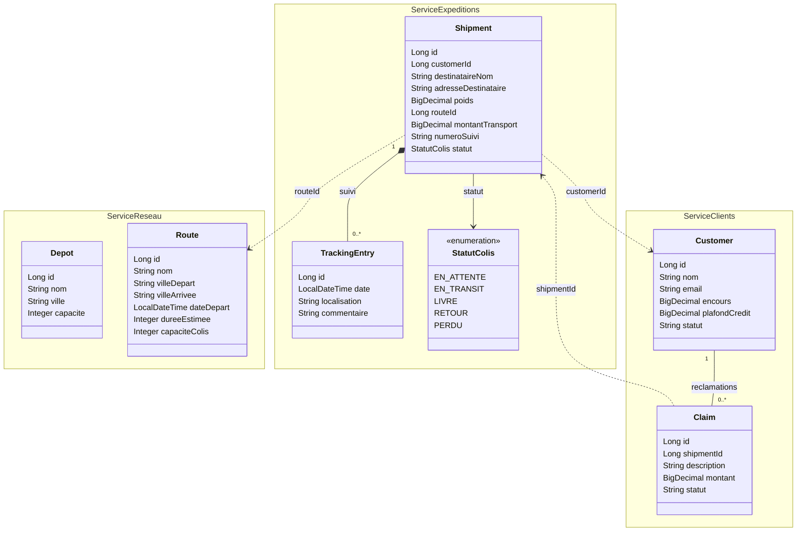
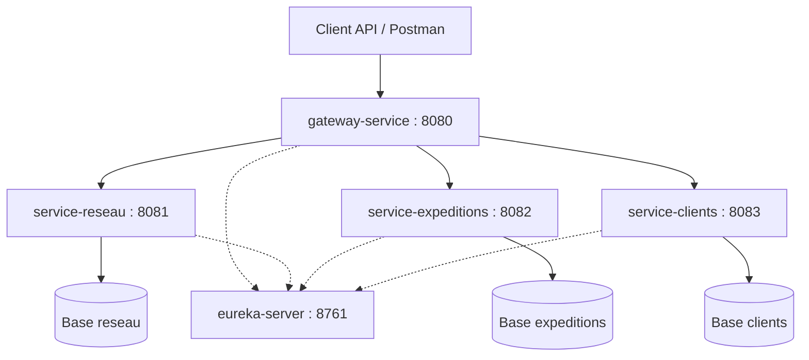

# Quick-Ship — Gestion et suivi de colis

## Présentation

Quick-Ship est une application de gestion d’expéditions.

Elle permet de gérer les clients expéditeurs, les dépôts logistiques,
les tournées de transport et les colis.

Chaque colis possède un numéro de suivi unique. Son parcours est
enregistré jusqu’à sa livraison, son retour ou sa déclaration de perte.
Un colis perdu ou retourné déclenche une réclamation client.

## Fonctionnalités prévues

- Gestion des dépôts et des tournées datées.
- Gestion des clients expéditeurs.
- Création d’une expédition avec calcul du montant côté serveur.
- Vérification du client et réservation de capacité avant départ.
- Suivi des différentes étapes du transport.
- Gestion des livraisons, retours et pertes.
- Consultation d’un colis enrichie avec le client, la tournée,
  les étapes de suivi et les réclamations.
- Notifications asynchrones.

## Cycle de vie d’un colis

Un colis commence à l’état EN_ATTENTE.
Après réservation de capacité sur une tournée, il passe à EN_TRANSIT.
Il peut ensuite devenir LIVRE, RETOUR ou PERDU.

## Services et ports prévus

| Application | Responsabilité | Port |
|---|---|---|
| service-reseau | Dépôts et tournées | 8081 |
| service-expeditions | Colis et étapes de suivi | 8082 |
| service-clients | Clients et réclamations | 8083 |
| eureka-server | Annuaire des services | 8761 |
| gateway-service | Point d’entrée des API | 8080 |

Chaque service métier possède sa propre base de données.
Aucun service ne consulte directement la base d’un autre service.

Le Config Server et le service de notification seront ajoutés
aux jalons correspondants.

## Diagramme de classes métier

Les associations à l’intérieur d’un service sont locales.
Les dépendances entre services sont représentées en pointillés :
elles indiquent une référence distante sans imposer un protocole.

Les références distantes customerId, routeId et shipmentId
sont stockées comme identifiants, sans association JPA interservice.

TrackingEntry appartient localement à Shipment dans service-expeditions.
Claim appartient localement à Customer dans service-clients.

Dans le périmètre initial, les tournées sont définies par leurs villes.
Aucune association entre Depot et Route n’est imposée par la fiche.

## Architecture globale cible du premier jalon

Les liens en pointillés vers Eureka représentent
l’enregistrement et la découverte des services.

## Organisation interne

Chaque service métier respecte les couches suivantes :

- Entity : modèle de données local.
- Repository : accès à la base de données.
- Service : règles métier et transactions.
- Controller : exposition des API REST.
- DTO : validation des entrées et structure des réponses.

## Règles métier principales

- Vérifier l’existence et le statut du client avant le départ.
- Contrôler son encours par rapport au plafond de crédit.
- Vérifier la destination et la capacité de la tournée.
- Réserver atomiquement une unité de capacité avant le départ.
- Calculer le montant du transport côté serveur.
- Libérer une seule fois la capacité à la fin du transport.
- Ajouter une seule fois le montant à l’encours après livraison.
- Créer une seule réclamation automatique par colis retourné ou perdu.
- Contrôler les transitions de statut par des opérations métier.
- Refuser les suppressions incompatibles avec l’historique.

## Plan de réalisation

| Jalon | Contenu |
|---|---|
| V0 | Conception, diagrammes et documentation |
| V1 | CRUD Depot, Route et Customer ; validation avec Postman |
| V2–V3 | Eureka, Gateway et Config Server |
| V4 | Expéditions, suivi, réclamations et OpenFeign |
| V5 | Notifications avec RabbitMQ |
| V6 | Résilience, Rate Limiting, erreurs et idempotence |
| V7 | Variante événementielle Kafka créée depuis V3 |

## État actuel

Projet en phase de conception.
Les services et leurs API ne sont pas encore implémentés.

Les prérequis techniques exacts et les instructions de démarrage
seront complétés lors de la création des modules.
